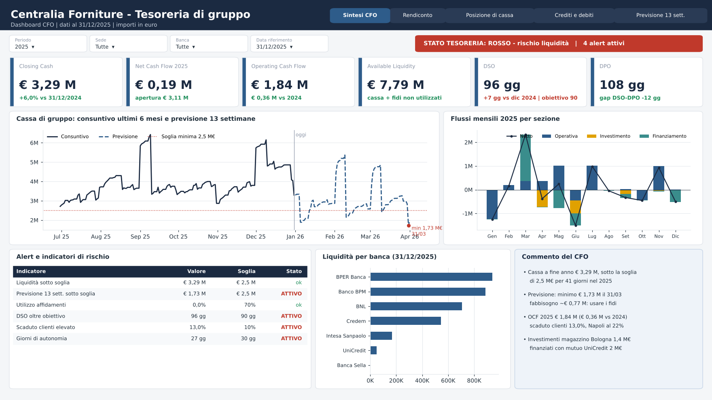

# Dashboard Cash Flow e Tesoreria 

Monitoraggio della liquidità e delle disponibilità bancarie.

Rendiconto finanziario a metodo diretto.

Analisi di crediti, debiti, scadenzari e insoluti.

Monitoraggio di DSO, DPO e utilizzo degli affidamenti.

Previsione dei flussi di cassa.

Alert automatici per individuare anticipatamente rischi di liquidità.

Dashboard Power BI composta da pagine interattive.

Risultato: un sistema integrato di Cash Management per monitorare la liquidità, anticipare i fabbisogni finanziari e supportare le decisioni aziendali.

Dati interamente simulati
