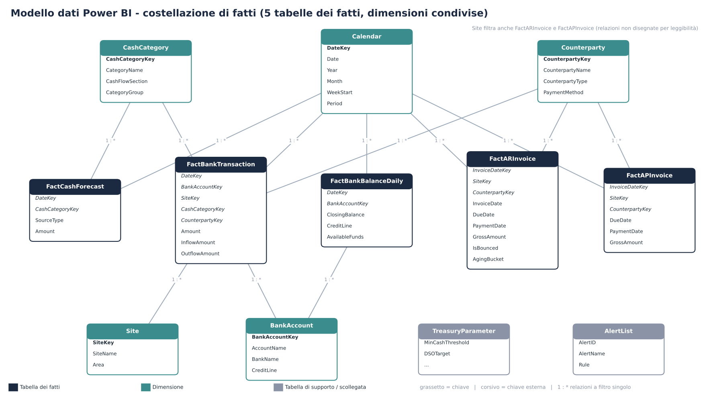
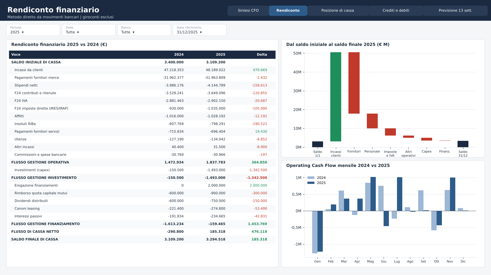
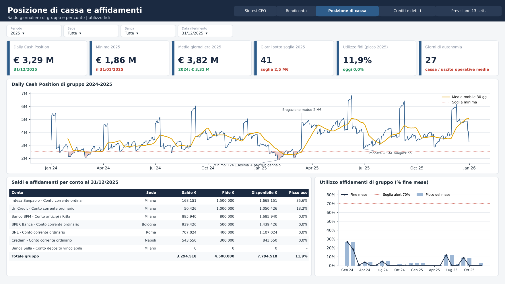
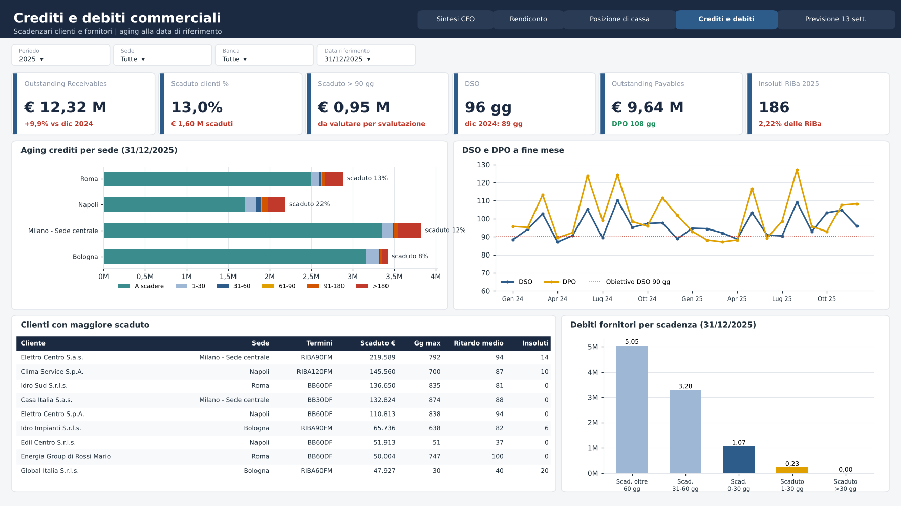
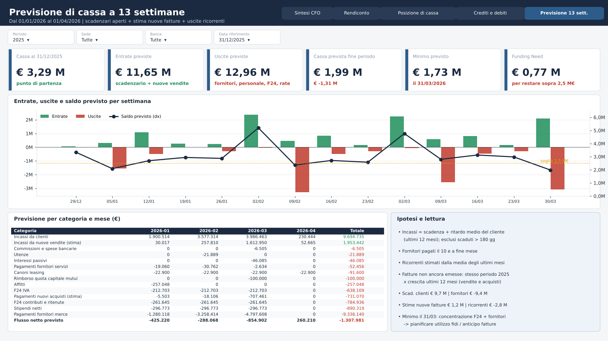

# Cash Flow e Tesoreria - dashboard per il CFO

**SQL Server · Power BI · DAX · Power Query · Python (generazione dati)**

Dashboard di tesoreria per un gruppo con quattro sedi: rendiconto finanziario a metodo diretto, posizione di cassa giornaliera per banca, utilizzo degli affidamenti, scadenzari clienti e fornitori, DSO/DPO, previsione di cassa a 13 settimane e un pannello di alert che segnala in anticipo i rischi di liquidità.

È il progetto più vicino al lavoro che ho fatto in amministrazione (prima nota, riconciliazioni bancarie, scadenziario, solleciti, RiBa, F24): ho provato a mettere in un modello dati le domande che il CFO faceva ogni lunedì mattina. Quanta cassa abbiamo? Ci basta per i pagamenti di fine mese? Chi non ci sta pagando?

Azienda e dati sono simulati (Centralia Forniture S.p.A., distribuzione di materiale elettrico e termoidraulico, sedi a Milano, Bologna, Roma e Napoli, circa 40 M€ di fatturato).


---

## Executive summary (dati al 31/12/2025)

| | 2024 | 2025 |
|---|---:|---:|
| Fatturato netto | 37,1 M€ | 39,8 M€ |
| Cassa iniziale | 3,40 M€ | 3,11 M€ |
| Operating Cash Flow | +1,47 M€ | +1,84 M€ |
| Investing Cash Flow | -0,15 M€ | -1,49 M€ |
| Financing Cash Flow | -1,61 M€ | -0,16 M€ |
| **Cassa finale** | **3,11 M€** | **3,29 M€** |
| Minimo giornaliero di cassa | 2,05 M€ (29/02) | 1,86 M€ (31/01) |
| Giorni sotto la soglia minima (2,5 M€) | 30 | 41 |

Al 31/12/2025: crediti aperti 12,3 M€ (scaduto 13,0%), debiti fornitori 9,6 M€, DSO 96 giorni, DPO 108 giorni, liquidità disponibile (cassa + fidi non utilizzati) 7,8 M€.

La previsione a 13 settimane mostra un minimo di **1,73 M€ il 31 marzo 2026**, sotto la soglia di 2,5 M€: fabbisogno stimato di circa 0,8 M€, coperto dagli affidamenti disponibili (4,5 M€) ma da pianificare per tempo.

## Il problema di business

Prima del progetto (scenario):

- la posizione di cassa si ricostruiva a mano ogni mattina scaricando gli estratti conto da sei home banking;
- lo scadenziario clienti stava in un file Excel per sede, aggiornato in modo diverso da ognuna;
- il CFO scopriva i momenti di tensione (gennaio-febbraio con F24 della tredicesima e pagamenti fornitori, giugno con le imposte) quando erano già arrivati;
- nessun indicatore condiviso su DSO, scaduto e utilizzo fidi da portare in banca o in CdA.

Obiettivi:

1. monitorare entrate, uscite, saldo e liquidità disponibile, anche giorno per giorno;
2. avere un rendiconto finanziario mensile (gestione operativa, investimenti, finanziamenti);
3. misurare crediti e debiti commerciali (DSO, DPO, aging, insoluti);
4. stimare il fabbisogno finanziario delle prossime 13 settimane;
5. avere alert automatici con soglie modificabili dalla tesoreria senza toccare il report.

## KPI

| KPI | Definizione |
|---|---|
| Opening Cash | saldo di gruppo alla fine del giorno precedente il periodo |
| Closing Cash | saldo di gruppo all'ultimo giorno del periodo (mai oltre la data di riferimento) |
| Operating Cash Flow | flussi della gestione operativa: incassi clienti, fornitori, personale, F24, affitti, utenze |
| Net Cash Flow | entrate - uscite, giroconti tra conti propri esclusi |
| Daily Cash Position | saldo di chiusura giornaliero, per gruppo o per conto |
| DSO | crediti aperti / fatturato (IVA inclusa) ultimi 90 giorni × 90 |
| DPO | debiti aperti / acquisti (IVA inclusa) ultimi 90 giorni × 90 |
| Outstanding Receivables | fatture emesse entro la data e non incassate a quella data |
| Outstanding Payables | fatture ricevute entro la data e non pagate a quella data |
| Available Liquidity | cassa + affidamenti non utilizzati |
| Credit Line Usage % | scoperto / affidamenti, calcolato conto per conto |
| Liquidity Days | cassa / uscite operative medie giornaliere degli ultimi 90 giorni |
| Funding Need 13W | quanto manca, nel punto di minimo previsto, per restare sopra la soglia |

## Struttura del repository

```
cash-flow-treasury/
├── data/                       estratti CSV (banche, scadenzari, anagrafiche)
├── python/generate_data.py     generazione del dataset simulato
├── sql/
│   ├── 01_create_database_and_tables.sql
│   ├── 02_populate_dim_date.sql
│   ├── 03_load_staging.sql
│   ├── 04_load_dw.sql              caricamento + snapshot saldi giornalieri + parametri
│   ├── 05_cash_forecast.sql        procedura di previsione a 13 settimane
│   ├── 06_reporting_views.sql
│   ├── 07_analysis_queries.sql
│   └── 08_data_quality_checks.sql
├── powerbi/
│   ├── measures.dax
│   └── power_query.m
├── docs/
│   ├── data_dictionary.md
│   └── dashboard_layout.md
└── images/
```

## Dataset

| File | Righe | Contenuto |
|---|---:|---|
| bank_transactions.csv | 27.956 | movimenti di estratto conto 2024-2025 su 7 conti |
| ar_invoices.csv | 25.780 | fatture attive da luglio 2023 (con data incasso e flag insoluto) |
| ap_invoices.csv | 5.713 | fatture passive merce e servizi |
| counterparties.csv | 556 | clienti, fornitori, erario, enti, banche, locatori |
| bank_accounts.csv | 7 | conti con affidamento di cassa |
| bank_opening_balances.csv | 7 | saldi al 31/12/2023 |
| cash_flow_categories.csv | 20 | categorie di cassa e sezione del rendiconto |
| sites.csv | 4 | sedi con organico |

Come sono costruiti i dati (in `python/generate_data.py`):

- **incassi** generati dalle fatture: scadenza in base ai termini (RiBa 60/90/120 gg fine mese, bonifico 30/60 gg data fattura, rimessa diretta) più un ritardo che dipende dal profilo del cliente. Le sedi del sud hanno più clienti ritardatari;
- **insoluti RiBa** (circa 2% delle RiBa): accredito salvo buon fine, riaddebito dopo 8-15 giorni con spese, poi bonifico a saldo dopo qualche settimana;
- **fornitori** pagati con bonifici raggruppati il 10 e a fine mese; a luglio, agosto e dicembre parte dei pagamenti slitta;
- **IVA** liquidata mensilmente dalle fatture del mese precedente (debito - credito, con riporto del credito) e versata il 16, più acconto di dicembre;
- **personale**: stipendi il 27, F24 contributi e ritenute il 16 del mese dopo, tredicesima a dicembre e quattordicesima a luglio (CCNL commercio);
- **altre uscite**: affitti trimestrali anticipati, utenze bimestrali, leasing, mutuo con rata semestrale, nuovo finanziamento da 2 M€ a marzo 2025 per il magazzino di Bologna, dividendi a maggio, saldo e acconti IRES/IRAP a giugno e novembre;
- **giroconti**: ogni venerdì le sedi girano alla sede centrale l'eccedenza oltre 250 k€, e la sede centrale copre il conto UniCredit quando va troppo in rosso.

## Database SQL Server

Schemi `stg` / `dw` / `rpt` come negli altri progetti. Le parti più interessanti:

- **Snapshot dei saldi giornalieri** (`dw.FactBankBalanceDaily`): un record per ogni giorno di calendario e ogni conto, calcolato con una somma cumulata (`SUM() OVER (PARTITION BY conto ORDER BY data)`) sul saldo iniziale. I saldi sono semi-additivi: si sommano tra conti ma non nel tempo, e averli già pronti rende semplici e veloci le misure su minimo, media e posizione giornaliera.
- **Procedura di previsione** `dw.usp_BuildCashForecast`:
  - crediti aperti → data di incasso attesa = scadenza + ritardo medio del cliente negli ultimi 12 mesi; gli scaduti oltre 180 giorni sono esclusi per prudenza;
  - debiti aperti → data del primo pay run utile (10 o fine mese);
  - fatture non ancora emesse → incassi e pagamenti dello stesso periodo dell'anno precedente (fatture emesse e pagate nella finestra), moltiplicati per la crescita degli ultimi 12 mesi. Senza questa parte la previsione sottostima gli incassi a breve (rimesse dirette, bonifici a 30 giorni);
  - uscite ricorrenti (stipendi, F24, IVA, affitti, leasing, rate) → importi stimati a ogni esecuzione dalla media degli ultimi mesi, date spostate al primo giorno lavorativo.
- **Tabella parametri** `dw.TreasuryParameter`: soglia minima di cassa, soglia utilizzo fidi, obiettivo DSO, soglia scaduto, giorni minimi di autonomia. Il report legge i valori da qui.
- **Quadrature** (script 08): giroconti a saldo zero ogni giorno, saldo finale = iniziale + movimenti, fatture incassate senza movimento bancario, coerenza segno/categoria, sconfinamenti oltre fido.

## Power Query

Le viste arrivano già pulite da SQL, in Power Query faccio solo le trasformazioni che dipendono dal report:

- parametro `AsOfDate` (data di riferimento) usato per calcolare giorni di scaduto, fascia di aging e flag "aperta alla data" sulle fatture;
- funzione `fnAgingBucket` riutilizzabile (a scadere, 1-30, 31-60, 61-90, 91-180, oltre 180);
- colonne di calendario per la previsione (settimana relativa, periodo consuntivo/previsione, etichetta settimana);
- classificazione dei pagamenti fornitori (anticipato, puntuale, in ritardo);
- pivot della tabella parametri da righe a colonne, per leggerla con un semplice `MAX()` nelle misure.

## Modello Power BI



Cinque tabelle dei fatti con dimensioni condivise (Calendar, Site, BankAccount, Counterparty, CashCategory). Due misure come esempio:

```dax
Closing Cash =
VAR _D = [Report Date]
RETURN
    CALCULATE ( SUM ( FactBankBalanceDaily[ClosingBalance] ), 'Calendar'[Date] = _D )
```

```dax
Outstanding Receivables =
VAR _D = [Report Date]
RETURN
    CALCULATE (
        SUM ( FactARInvoice[GrossAmount] ),
        REMOVEFILTERS ( 'Calendar' ),
        FactARInvoice[InvoiceDate] <= _D,
        FILTER (
            ALL ( FactARInvoice[PaymentDate] ),
            ISBLANK ( FactARInvoice[PaymentDate] ) || FactARInvoice[PaymentDate] > _D
        )
    )
```

La seconda è quella su cui ho perso più tempo: la relazione con il calendario è sulla data fattura, ma "credito aperto al 30 giugno" dipende sia dalla data fattura sia dalla data di incasso. Rimuovendo il filtro del calendario e ricostruendolo sulle due date, la misura funziona per qualsiasi data passata e quindi anche DSO e aging si possono vedere mese per mese.

Le altre misure (previsione cumulata, utilizzo fidi conto per conto, alert, messaggi dinamici) sono in `powerbi/measures.dax`, ognuna con un commento.

## Alert e indicatori di rischio

| Alert | Regola | Stato al 31/12/2025 |
|---|---|---|
| Liquidità sotto soglia | cassa di gruppo < 2,5 M€ | ok (3,29 M€) |
| Previsione sotto soglia | minimo previsto a 13 settimane < 2,5 M€ | **attivo** (1,73 M€ il 31/03) |
| Utilizzo affidamenti | scoperto / fidi > 70% | ok (picco 2025: 12% di gruppo, 36% sul conto Intesa) |
| DSO oltre obiettivo | DSO > 90 giorni | **attivo** (96) |
| Scaduto clienti | scaduto / crediti aperti > 10% | **attivo** (13,0%) |
| Giorni di autonomia | cassa / uscite medie giornaliere < 30 | **attivo** (27) |

Lo stato complessivo diventa rosso se la cassa attuale o quella prevista scendono sotto soglia, giallo con almeno due alert attivi, verde altrimenti.

## Dashboard

Le immagini sono i mockup delle pagine, costruiti con i dati del progetto. Il dettaglio dei visual è in [docs/dashboard_layout.md](docs/dashboard_layout.md).

| Pagina | Contenuto |
|---|---|
| Sintesi CFO | stato tesoreria, 6 KPI, cassa consuntiva + prevista, flussi mensili per sezione, tabella alert, liquidità per banca, commento |
| Rendiconto | rendiconto finanziario a metodo diretto 2025 vs 2024, waterfall saldo iniziale → finale, OCF mensile |
| Posizione di cassa | saldo giornaliero di gruppo con giorni sotto soglia, saldi e fidi per conto, utilizzo affidamenti |
| Crediti e debiti | crediti e scaduto, aging per sede, DSO/DPO mensili, clienti con maggiore scaduto, debiti per scadenza |
| Previsione 13 settimane | entrate, uscite e saldo previsto per settimana, dettaglio per categoria e mese, ipotesi |









## Cosa emerge dai dati

1. **La crescita del fatturato non si trasforma in cassa.** Nel 2025 il fatturato cresce del 7,4% (+2,7 M€), ma gli incassi da clienti solo di 1,0 M€: il resto è rimasto nei crediti, con il DSO passato da 89 a 96 giorni. La cassa di fine anno (3,29 M€) è praticamente uguale a quella di fine 2024.
2. **Il primo trimestre è il periodo più teso, ogni anno.** Il minimo di cassa cade a fine gennaio-febbraio (2,05 M€ nel 2024, 1,86 M€ nel 2025): a gennaio si sommano l'F24 con i contributi sulla tredicesima, l'IVA di dicembre e i pagamenti delle forniture di ottobre-novembre a 90 giorni, mentre gli incassi di dicembre sono bassi. La previsione conferma lo stesso schema per marzo 2026.
3. **Lo scaduto clienti è il punto debole**: 13,0% dei crediti aperti, con Napoli al 22% (contro l'8% di Bologna). 0,95 M€ sono scaduti da oltre 90 giorni e andrebbero valutati per contenzioso o svalutazione. Gli insoluti RiBa sono saliti da 0,61 a 0,80 M€: i clienti con più scaduto sono anche quelli con più insoluti, candidati al pagamento anticipato o a un fido commerciale ridotto.
4. **DSO 96 contro DPO 108**: l'azienda oggi paga mediamente più tardi di quanto incassa, ed è questo che tiene in equilibrio il circolante. Se i fornitori accorciassero i termini, il fabbisogno salirebbe subito.
5. **Investimenti finanziati nel modo giusto**: 1,4 M€ di capex sul magazzino di Bologna coperti dal finanziamento UniCredit da 2 M€ a 60 mesi, senza pesare sui fidi a breve. Senza quel finanziamento la cassa di fine 2025 sarebbe stata intorno a 1,6 M€.
6. **Previsione**: il 31 marzo 2026 la cassa prevista scende a 1,73 M€ (pay run di fine mese, F24 e rata del finanziamento nella stessa settimana). Il fabbisogno di circa 0,8 M€ è coperto dai fidi non utilizzati, ma conviene muoversi prima: anticipo fatture sulle RiBa di aprile, sollecito mirato su Napoli, eventuale spostamento di una parte dei pagamenti di fine marzo.

## Limiti

- Le fatture non ancora emesse sono stimate sullo storico dell'anno precedente: con un budget di vendite e acquisti mensile la stima sarebbe più precisa.
- Pagamenti parziali e compensazioni non sono modellati (ogni fattura è incassata o aperta per intero).
- DSO calcolato con il metodo semplice a 90 giorni; il metodo "count-back" sarebbe più preciso nei mesi con fatturato molto variabile.

## Come riprodurre

1. (opzionale) `python python/generate_data.py`
2. Eseguire gli script SQL da 01 a 06 (nel 03 impostare `@DataPath`), poi 08 per i controlli
3. In Power BI: parametri `ServerName`, `DatabaseName`, `AsOfDate`; query da `powerbi/power_query.m`; tabella calcolata `AlertList` e misure da `powerbi/measures.dax`

---

Andrea Pollastrelli · [Portfolio](https://andreapollastrelli95.github.io/)

Dati interamente simulati: aziende e persone sono di fantasia, i nomi di banche e fornitori sono usati solo per rendere realistico lo scenario.
